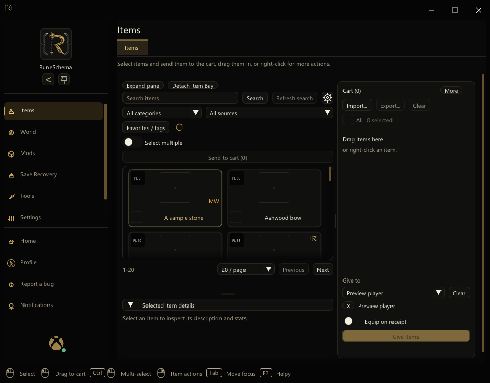
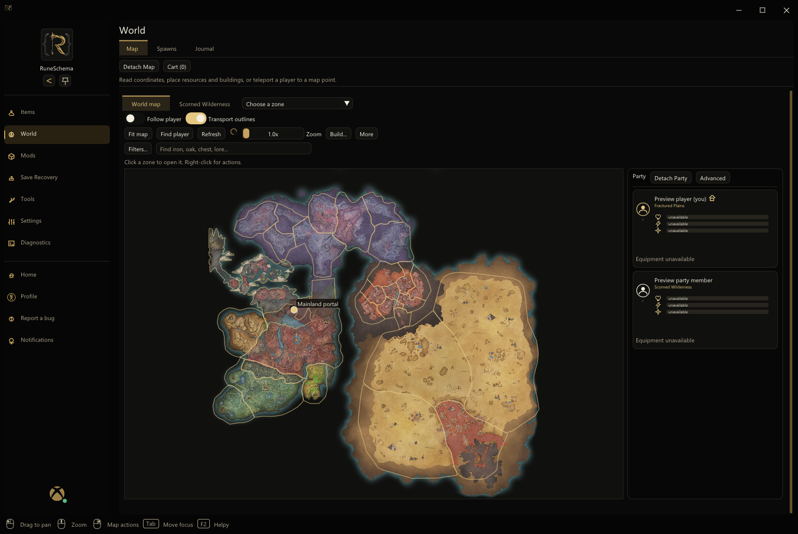
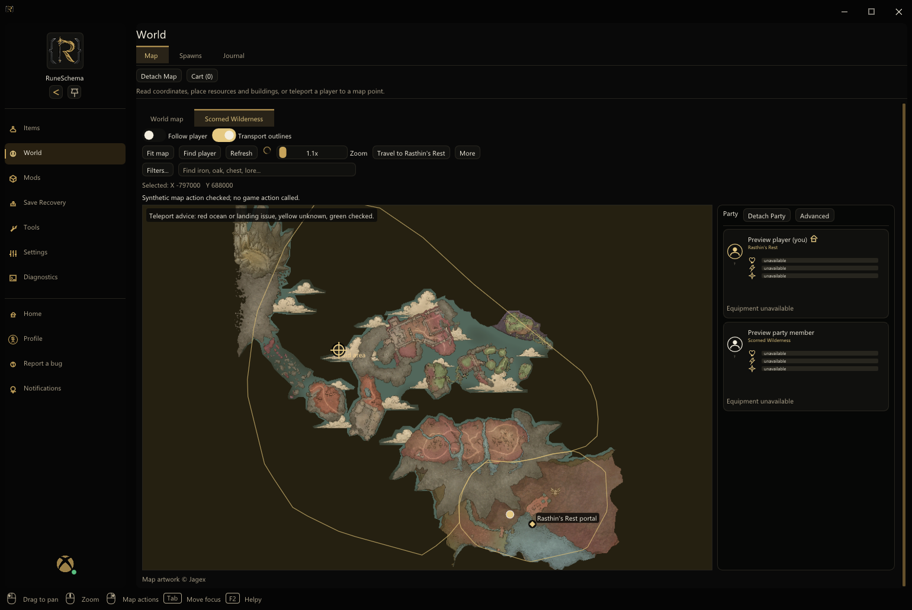
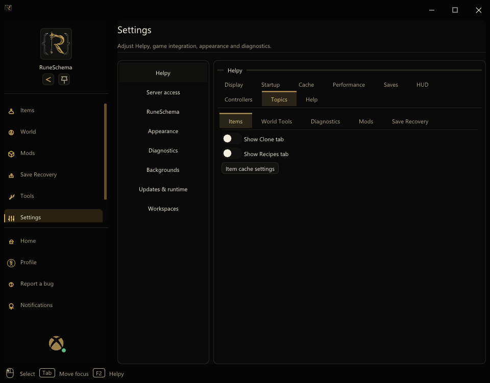
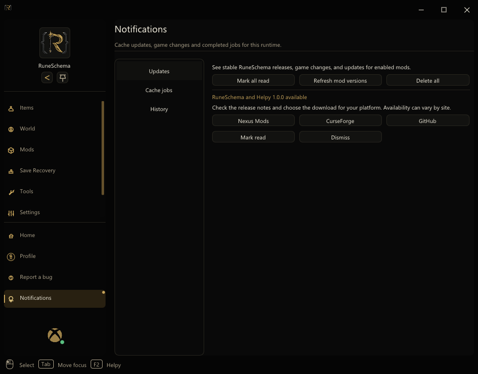
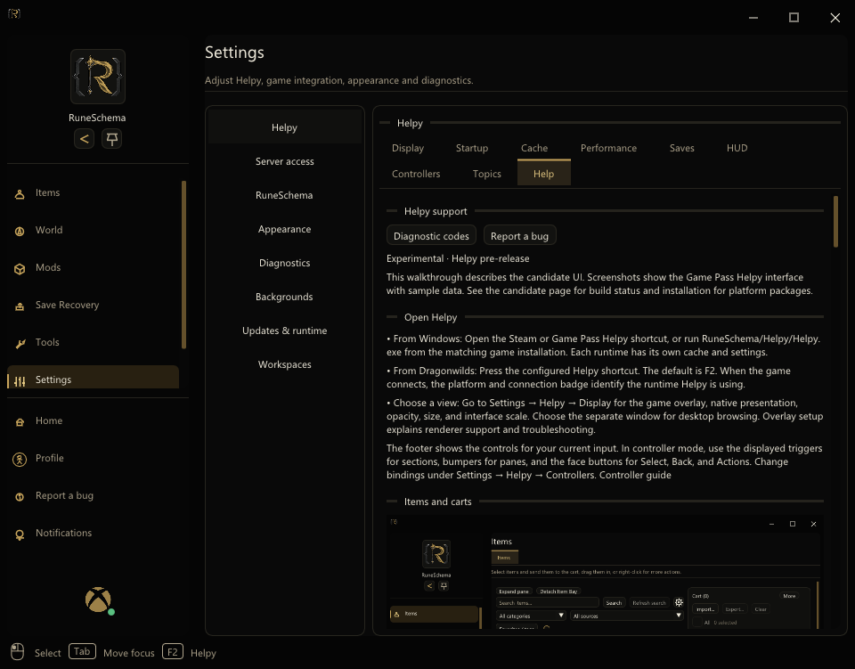

# Helpy support

!!! info "Experimental · Helpy pre-release"
    This walkthrough describes the candidate UI. Screenshots show the Game
    Pass Helpy interface with sample data. See the [candidate page](PRE-RELEASE.md)
    for build status and [installation](INSTALLATION.md) for platform packages.

## Open Helpy

- **From Windows:** Open the Steam or Game Pass Helpy shortcut, or run
  `RuneSchema/Helpy/Helpy.exe` from the matching game installation. Each
  runtime has its own cache and settings.
- **From Dragonwilds:** Press the configured Helpy shortcut. The default is
  **F2**. When the game connects, the platform and connection badge identify
  the runtime Helpy is using.
- **Choose a view:** Go to **Settings → Helpy → Display** for the game overlay,
  native presentation, opacity, size, and interface scale. Choose the
  separate window for desktop browsing. [Overlay setup](NATIVE-OVERLAY.md)
  explains renderer support and troubleshooting.

The footer shows the controls for your current input. In controller mode, use
the displayed triggers for sections, bumpers for panes, and the face buttons
for Select, Back, and Actions. Change bindings under **Settings → Helpy →
Controllers**. [Controller guide](CONTROLLER-NAVIGATION.md)

## Items and carts

1. Open **Items**. Search by display name, then use the category and source
   filters to narrow the results. Choose a mod in the source filter to see
   its entries.
2. Drag an item to the cart or enable **Select multiple**, select several
   cards, and choose **Send to cart**.
3. To deliver one item, open its actions and choose **Send to player**.
   Set the quantity and select a connected player. To deliver a cart,
   select a recipient and use **Give items**.

Cached items, pictures, and carts can be browsed while Dragonwilds is
closed. Live delivery needs a connected game and permission. **Refresh
search** checks for new matches when the game is connected. The Item Bay
cog switches between display names and internal names.

**Clone** and **Recipes** are optional tabs. Enable either from
**Settings → Helpy → Topics → Items**. [Delivery guide](ITEM-DELIVERY.md)

## World map

- **Left-click** a zone on the world map to open its close-up. **Right-click**
  for map actions. Drag to pan and use the mouse wheel or zoom control to
  zoom. **Fit map** resets the current view.
- Toggle **Transport outlines** to show the zone and portal guides. **Find
  player** centers on your character. **Follow player** switches to the
  character's current area until you pick a different one.
- Open **Scorned Wilderness** for its separate artwork and coordinate
  space. Click the map to select X/Y coordinates. Available travel actions
  use the host's confirmation and ground checks.

## Mods, caches, and recovery

| To do this | Open |
| --- | --- |
| Inspect RuneSchema or UE4SS mods, stage their order or enabled state, and see available licenses | **Mods → Management** |
| Review the server's reported mods and compare versions | **Mods → Management → Server comparison** |
| Build caches for the enabled RuneSchema mods | **Mods → Cache enabled mods** or the action on **Home** |
| Build an individual mod cache or prepare a package | **Tools → Utilities → Authoring tools** |
| Verify and repair RuneSchema's base files | **Tools → Utilities → Repair**, with Dragonwilds closed |
| Edit a compatible mod's settings | **Mods → Mod Menu 2**, with the activation key and option enabled |
| Review a character snapshot and restore it | **Save Recovery**, with Dragonwilds closed for restoration |

Mod changes apply the next time the game launches. Offline Mod Menu 2 writes
supported settings to the mod's declared config. Buttons and features that
depend on a live character or running game are available when connected.
Save Recovery records which mods were active at the time of a snapshot.
World recovery is an opt-in setting.

[Mod and loader controls](MOD-METADATA-AND-CONTROLS.md) ·
[Mod Menu 2](MOD-MENU-2-AND-HUD.md) · [Save recovery](SAVE-RECOVERY.md)

## Find a setting

Open **Settings → Helpy** and choose a tab across the top.

| Tab | Controls |
| --- | --- |
| Display | Window mode, overlay presentation, size, opacity, and scale |
| Startup | Auto-start, tray behavior, and the Helpy shortcut |
| Cache | Cache-first browsing and background content discovery |
| Performance | Frame-rate options and resource or UE4SS diagnostics |
| Saves | Launch behavior, cleanup and recovery options |
| HUD | Position and configure supported in-game HUD elements |
| Controllers | Input mode, device bindings, glyphs, pointer and touchpad |
| Topics | Advanced controls and links for Items, World Tools, Diagnostics, Mods, and Save Recovery |
| Help | This guide, diagnostic code reference, and bug reporting |
| Mod Menu 2 | Activation and shortcut settings when the plugin is unlocked |

Use the left settings column for **Server access**, **RuneSchema**,
**Appearance**, **Diagnostics**, **Backgrounds**, **Updates & runtime**,
and **Workspaces**.

## Updates and diagnostic codes

**Notifications → Updates** shows stable RuneSchema releases, game updates,
and cache changes. A stable release notice links to GitHub, Nexus Mods, and
CurseForge. Check manually from **Settings → Updates & runtime → Check now**.
An emergency hotfix uses its own review flow.

Enable **Diagnostics** from **Settings → Helpy → Topics → Diagnostics** if
it is hidden. Open the affected session and look for the code beside the
event. The [complete code reference](../ERROR-CODES.md) explains each code.

| Code | What to check |
| --- | --- |
| [RS-OVL-002](../ERROR-CODES.md#rs-ovl-002) | Native overlay could not open. Check the current display and overlay status. |
| [RS-UI-002](../ERROR-CODES.md#rs-ui-002) | Standalone Helpy could not start. Verify the executable and its companions are in the selected runtime folder. |
| [RS-PLUG-002](../ERROR-CODES.md#rs-plug-002) | A plugin manifest points to a missing DLL. Check the plugin's files against the package. |
| [RS-CACHE-003](../ERROR-CODES.md#rs-cache-003) | The cache and installed content differ. Refresh or rebuild for the matching runtime and mods. |
| [RS-NET-001](../ERROR-CODES.md#rs-net-001) | Client and server content differ. Check **Mods → Server comparison**. |
| [RS-SAVE-005](../ERROR-CODES.md#rs-save-005) | A snapshot or recovery needs review. Read the recorded issue before attempting another restore. |

## Get help

Choose **Settings → Helpy → Help** to read this guide inside Helpy. The
desktop window displays the website and can use the bundled copy offline.
The game overlay displays the guide in its own scrollable panel.
When reporting a bug,
include the RuneSchema and Helpy versions, Steam or Game Pass, UE4SS build,
reproduction steps, and the relevant code or log excerpt. For an overlay
issue, include the game display mode and input device. Review logs for
personal information before sharing.

[Report a bug on Nexus Mods](https://www.nexusmods.com/runescapedragonwilds/mods/570?tab=bugs)
